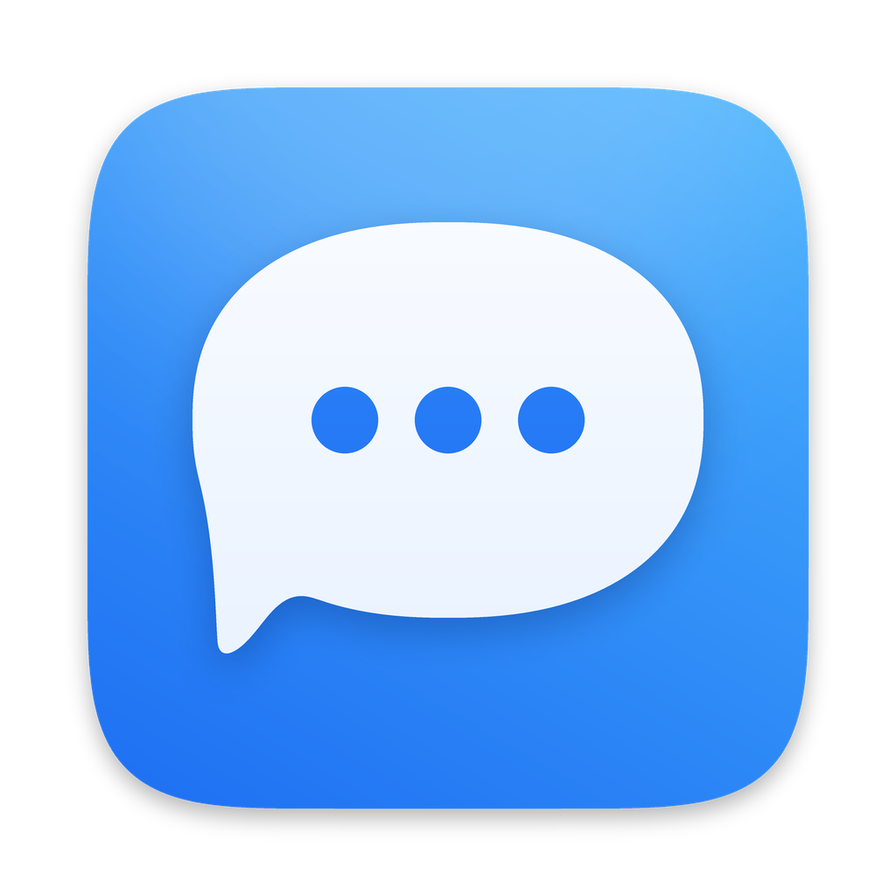

<p align="center"></p>

# Goob Message


This was made completely by Claude. I have absolutely NO idea what I'm doing, 
I just wanted a client for google messages on desktop because Google doesn't provide one.
Probably wont update because the current version works fine, feel free to fork :D


*(Repo/target name: GMessagesMac.)*

A **native SwiftUI macOS client for Google Messages**, designed to feel like Apple's Messages. It speaks Google's
Messages-for-web protocol directly (a Swift port of [libgm](https://github.com/mautrix/gmessages)) — no embedded web
client for the chat UI. Your phone stays the source of truth; this is a paired "web" session.

> Unofficial. Uses an undocumented API that Google can change at any time. Use with your own account. See `NOTICE.md`.

## Features
- **Chats:** inbox / archive, unread dots, pinned chats, group chats with group icons (or a member-photo collage), new conversation from contacts, archive / delete, search, find in conversation (⌥⌘F).
- **Messages:** send & receive SMS/RCS, replies, reactions (hover button, long-press or right-click), delete, copy, typing indicators, Delivered / Read, big-emoji messages, link previews, drafts per chat.
- **Media:** photos, video, files: view, play, save, share; paste, drag-drop or **+** to attach (HEIC and other Mac-only image types are converted to JPEG). **Voice messages:** record with the mic button, play inline.
- **Notifications:** reply or mark as read from the banner, one notification per conversation instead of one per message, a single summary for messages that arrived while your Mac was asleep, per-chat **Hide Alerts**, preview / sound settings.
- **Mac niceties:** optional menu bar icon with unread chats, Open at Login, Dock badge, reconnects cleanly after sleep or a network change, shortcuts (⌘N new, ⌘F search, ⌥⌘F find, ⌥⌘↑/↓ switch chats, ⌘R reload, ⌘, settings).

## Build & run
```bash
brew install protobuf swift-protobuf
pip3 install grpcio-tools pillow
./generate.sh                 # generates protobuf code + schema (once, and after editing Protos/)
open Package.swift            # Xcode: choose the GMessagesMac scheme, ⌘R
swift test                    # optional
```
**Install as a real app** (icon, notifications, Dock identity):
```bash
./scripts/make_app.sh         # -> build/Goob Message.app (universal)
./scripts/make_dmg.sh         # -> build/GoobMessage.dmg
cp -R "build/Goob Message.app" /Applications/
```
First launch of an unsigned app: open it once, then System Settings → Privacy & Security → **Open Anyway** (or run `xattr -dr com.apple.quarantine "/Applications/Goob Message.app"`). Notifications, voice messages and Open at Login only work in this `.app`, not when run from Xcode.

## First run
Click **Sign in with Google** → sign in with the account on your Android phone → keep Google Messages open on the phone
→ tap the emoji shown on the Mac, on your phone. Credentials live in the macOS Keychain.

## Contributing
See `CONTRIBUTING.md` and **`AGENTS.md`** (architecture, protocol gotchas, conventions — written for AI agents and humans).
Security: `SECURITY.md`. Protocol notes: `docs/PROTOCOL.md`.

## License
AGPL-3.0-or-later (derivative of libgm). See `LICENSE` and `NOTICE.md`.
